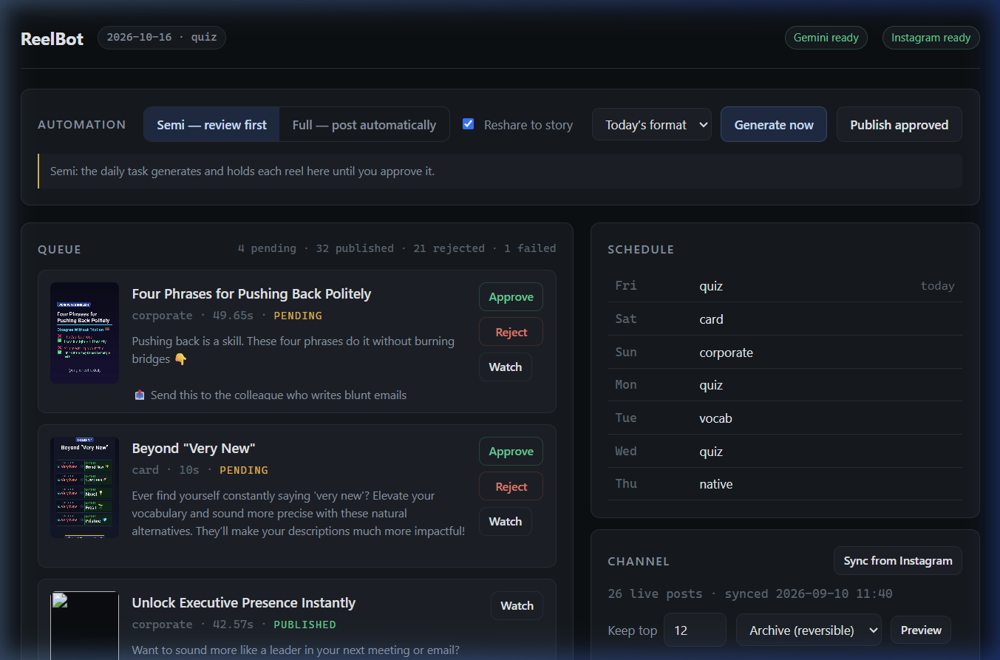
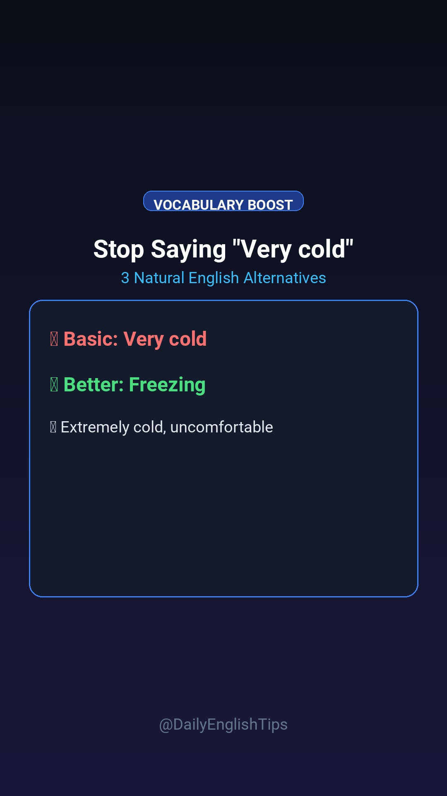
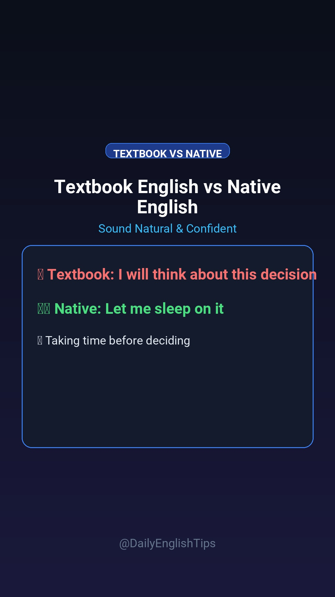
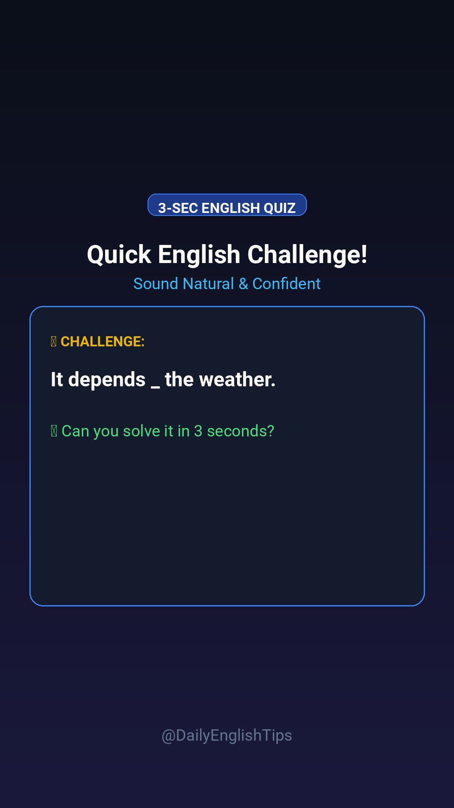
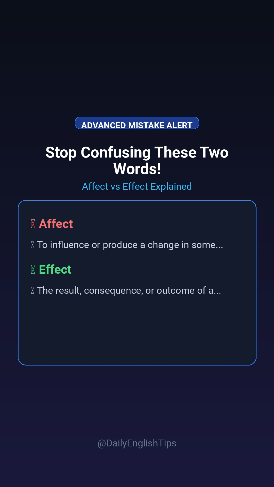
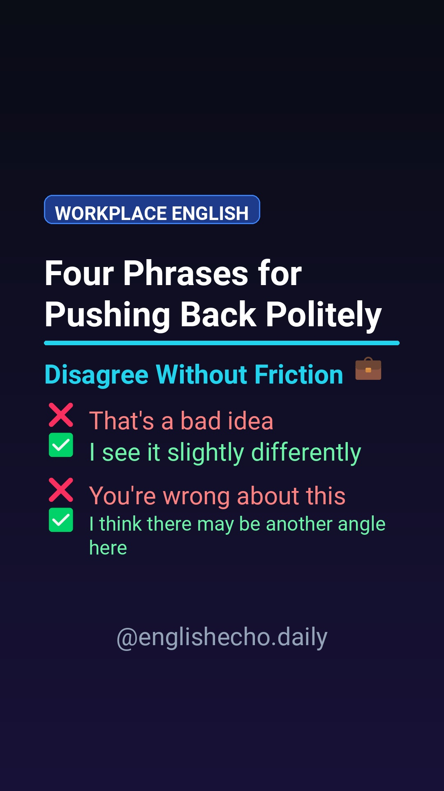
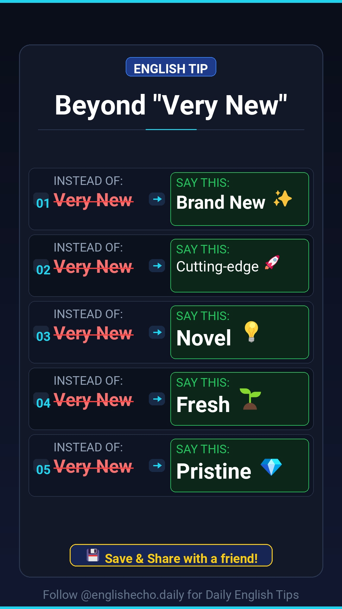

# ReelBot — Automated English-Learning Instagram Reels

[](https://www.python.org/downloads/)
[](https://fastapi.tiangolo.com/)
[](https://opensource.org/licenses/MIT)

Generates a daily English-learning Reel (1080×1920 vertical video, edge-tts narrated, procedural Lo-Fi background music and sound effects), holds it in a web review queue, and publishes what you approve directly to Instagram with automated story preview reshares.



```bash
reelbot web             # dashboard at http://127.0.0.1:8000
reelbot doctor          # check the install
reelbot generate        # make one reel now
reelbot queue list      # see what is waiting for review
reelbot publish         # upload everything approved
reelbot sync            # read the account's live posts
reelbot prune-channel   # keep only the best N on the grid (dry run)
```

---

## Setup

```bash
pip install -e .
copy .env.example .env      # then fill in your keys
reelbot doctor
```

`doctor` verifies credentials, dependencies, ffmpeg, and fonts. Everything it
reports as `WARN` is optional; `FAIL` will stop a run.

### Configuration (`.env`)

| Variable | Purpose | Default |
|---|---|---|
| `GEMINI_API_KEY` | AI lesson generation. Without it, curated fallback lessons are used. | — |
| `GEMINI_MODEL` | Model id. | `gemini-2.5-flash` |
| `INSTAGRAM_USERNAME` / `INSTAGRAM_PASSWORD` | Only needed to publish. | — |
| `TTS_VOICE` | Narrator. `reelbot voices` lists them. | `guy` |
| `BRAND_HANDLE` | Shown on cards and thumbnails. **Set this to your real handle.** | `@DailyEnglishTips` |
| `PUBLISH_MODE` | `review` (approve manually) or `auto` (post unattended). | `review` |
| `SHARE_TO_STORY` | Reshare each published reel to Stories as a tappable preview. | `true` |
| `VIDEO_FPS`, `CARD_DURATION_SEC` | Render tuning. | `24`, `10` |

---

## Daily automation

Register the Windows scheduled task:

```powershell
powershell -ExecutionPolicy Bypass -File scripts\install_task.ps1 -Time 09:00
```

It runs `run_daily.bat` once a day, which generates the format scheduled for
that weekday and **queues it for review** — nothing is posted without your
approval unless you set `PUBLISH_MODE=auto`.

The job is idempotent per date, so a task that catches up after the machine was
asleep will not produce a second reel for the same day.

```powershell
Start-ScheduledTask -TaskName "ReelBot Daily"    # test it now
Get-Content logs\scheduler.log -Tail 20          # see what happened
powershell -ExecutionPolicy Bypass -File scripts\install_task.ps1 -Remove
```

### Weekly rotation

| Day | Format |
|---|---|
| Monday | `quiz` |
| Tuesday | `vocab` |
| Wednesday | `quiz` |
| Thursday | `native` |
| Friday | `quiz` |
| Saturday | `card` |
| Sunday | `corporate` / `mistake`, alternating by week |

Quiz runs three times a week because the account's own numbers put quizzes in
three of its top four reels (1,188 / 530 / 223 views against a median of 130).
Seven slots cannot hold that plus all five other formats, so Sunday alternates
by ISO week parity — every format still circulates on a two-week cycle.

Change it in `data/schedule.json` (an explicit Sunday entry disables the
alternation):

```json
{ "rotation": { "saturday": "vocab", "sunday": "card" } }
```

`reelbot schedule` prints the active rotation and the next seven days.

---

## Dashboard

```bash
reelbot web
```

A local control panel at `http://127.0.0.1:8000`: the queue with thumbnails and
captions, approve/reject/publish, generate on demand, the weekly schedule, live
channel performance, and the retention planner.

**It binds to localhost and has no authentication**, because it can reach your
Instagram session. Do not put it on a network interface.

### Full vs semi automation

The switch at the top writes `publish_mode` to `data/settings.json`, which
layers over `.env`, so it takes effect immediately and survives restarts.

| Mode | The daily task... |
|---|---|
| **Semi** (default) | generates the reel and holds it in the queue for your approval |
| **Full** | generates *and* publishes without asking |

Only four settings are changeable from the UI — `publish_mode`,
`share_to_story`, `tts_voice`, `brand_handle`. Credentials stay under `.env`
control so a UI bug cannot rewrite them.

---

## Channel history and retention

```bash
reelbot sync                      # pull live posts + their view counts
reelbot prune-channel --keep 12   # dry run: what would be retired
reelbot prune-channel --keep 12 --apply
```

`sync` mirrors what is actually on the account — including posts made by hand
and how each one performed — into `data/published.json`. Retention ranks by
views, then comments, then likes.

Two modes, and the difference is the whole point:

| Mode | Effect | Reversible |
|---|---|---|
| `archive` (default) | hidden from the grid, kept on the account with its numbers | yes, `media_unarchive` |
| `delete` | gone: post, views, comments and saves | **no** |

Deleting needs **both** `--apply` and `--yes-delete-permanently`; the dashboard
asks twice. Posts younger than 7 days are never retired — a reel earns most of
its reach in the first days, so judging it early would retire something still
climbing.

Archive is the default deliberately. Deleting a post destroys its accumulated
reach, and a sparser grid is not something Instagram rewards.

---

## The review queue

```bash
reelbot queue list
reelbot queue approve <id>      # or: approve all
reelbot queue reject <id>
reelbot publish                 # uploads every approved item
reelbot queue prune             # drop old published/rejected entries
```

States: `pending → approved → published`, plus `rejected` and `failed`.
Only `approved` items are ever uploaded.

### Story reshare

Publishing also posts the reel to Stories as a tappable preview, which puts it
in front of existing followers immediately — their early engagement is the
first signal the algorithm reads. `render/story.py` draws a backdrop that keeps
its own content clear of the band Instagram fills with the reshared post
(roughly y 384–1536) and of the story UI.

The backdrop carries the reel's own headline, its format badge, a per-format
accent colour and a matching tap prompt ("Can you solve it?" for a quiz, "Don't
get this wrong" for a mistake reel). An earlier version drew only a generic
"NEW TODAY" card, which made every story byte-identical and gave a viewer no
reason to tap; a test now asserts backdrops differ per format and per title.

The reshared post is placed explicitly rather than on instagrapi's centred
default, so there is room for a readable headline above it.

It is best-effort: the reel is already live when the story runs, so any failure
is logged and ignored rather than marking a successful publish as failed. Turn
it off with `SHARE_TO_STORY=false`.

---

## Content formats

| Format | Badge | Narrated | Items | Shape | Sample Reel | Preview |
|---|---|---|---|---|---|---|
| **Vocabulary Upgrade** (`vocab`) | `VOCABULARY BOOST` | yes | 3 | Overused phrase → natural alternatives | [▶ Watch Reel](assets/samples/reel_vocab.mp4) |  |
| **Textbook vs Native** (`native`) | `TEXTBOOK VS NATIVE` | yes | 3 | Textbook phrasing → what natives say | [▶ Watch Reel](assets/samples/reel_native.mp4) |  |
| **3-Second Quiz** (`quiz`) | `3-SEC TRICKY QUIZ` | yes | 4 options | Question → 3s countdown → reveal | [▶ Watch Reel](assets/samples/reel_quiz.mp4) |  |
| **Common Mistake** (`mistake`) | `COMMON MISTAKE ALERT` | yes | 2 | Confusing word pair → memory trick | [▶ Watch Reel](assets/samples/reel_mistake.mp4) |  |
| **Workplace English** (`corporate`) | `WORKPLACE ENGLISH` | yes | 4 | Blunt phrasing → executive phrasing | [▶ Watch Reel](assets/samples/reel_corporate.mp4) |  |
| **Premium Card** (`card`) | `ENGLISH TIP` | no | 5 | Single cheat-sheet card over music bed | [▶ Watch Reel](assets/samples/reel_card.mp4) |  |

### Format Gallery & Single Reel Previews

<div align="center">
<table>
<tr>
<td align="center" width="33%">
<b>Vocabulary Upgrade</b><br>
<br>
<a href="assets/samples/reel_vocab.mp4">▶ <b>Watch Single Reel</b></a>
</td>
<td align="center" width="33%">
<b>Textbook vs Native</b><br>
<br>
<a href="assets/samples/reel_native.mp4">▶ <b>Watch Single Reel</b></a>
</td>
<td align="center" width="33%">
<b>3-Second Tricky Quiz</b><br>
<br>
<a href="assets/samples/reel_quiz.mp4">▶ <b>Watch Single Reel</b></a>
</td>
</tr>
<tr>
<td align="center" width="33%">
<b>Common Mistake Alert</b><br>
<br>
<a href="assets/samples/reel_mistake.mp4">▶ <b>Watch Single Reel</b></a>
</td>
<td align="center" width="33%">
<b>Workplace English</b><br>
<br>
<a href="assets/samples/reel_corporate.mp4">▶ <b>Watch Single Reel</b></a>
</td>
<td align="center" width="33%">
<b>Premium Card</b><br>
<br>
<a href="assets/samples/reel_card.mp4">▶ <b>Watch Single Reel</b></a>
</td>
</tr>
</table>
</div>

**Card captions carry the examples.** The card image has room for five swaps
but not for example sentences, so `content/captions.py` appends them from
`items` — one line per alternative with a short sentence using it. The model is
told to write only a short hook and *not* to list the alternatives, so the
appended block is the single source of that list. Narrated formats show their
examples on screen, so they get no such block.

Hashtags are **not** written by the model. `reelbot.content.hashtags` composes
**15** rotating tags per post (2 core + 3 format-specific + 6 niche + 4 broad,
least-recently-used first, sampled from a wider band so consecutive posts do not
share a predictable block).

Fifteen, not five and not thirty. Mosseri confirmed in July 2026 that hashtags
"have never been a good way to actually increase your reach" — they categorise a
post rather than distribute it. That argues against a wall of forty generic tags;
it does not argue for five, which gave the classifier almost nothing to work with
and left the post out of every niche feed it could plausibly have ranked in. The
pools lean niche on purpose: a small account ranks in `#englishtipsdaily` and
never in `#english`.

Every lesson also carries a **`send_cta`** — a line naming a specific person to
send the reel to ("Send this to the friend who always says 'very busy'"). It is
rendered on the outro slide and repeated in the caption. DM sends are the
heaviest-weighted reel signal, well above likes, and a generic "share this"
does not trigger them.

---

## Layout

```
src/reelbot/
  cli.py            command line entry point
  pipeline.py       lesson → narration → video → queue
  settings.py       typed config from .env
  formats.py        the format registry
  content/          prompts, fallback lessons, Gemini client, hashtags
  audio/            scene building, Edge-TTS narration, generated music/SFX
  render/           fonts, theme, text layer, slides, card, video compositor
  publish/          review queue, Instagram client, channel sync, retention
  web/              dashboard (FastAPI + a single page)
  planner/          weekly calendar, daily runner
  store/            paths, atomic JSON, topic history
data/               state: history, queue, calendar, session  (git-ignored)
Reels/              rendered output                           (git-ignored)
archive/            pre-restructure code, kept for reference
```

Two files are data, not code, and are meant to be edited:

- `src/reelbot/content/format_prompts.json` — the editorial brief per format.
- `src/reelbot/content/fallback_lessons.json` — lessons used when Gemini is
  unreachable. 48 lessons, 8 per format, each a distinct topic. Selection is
  least-recently-used, so the whole pool is spent before anything repeats.

---

## Development

```bash
pytest                    # 649 tests, no network required
reelbot generate --format quiz --voice jenny
reelbot -v run-daily --force
```

### Design constraints (why the layout looks the way it does)

These are platform constraints, not preferences, and `tests/test_design_constraints.py`
guards them:

| Constraint | Value | Reason |
|---|---|---|
| Bottom unsafe band | 280px | Instagram's caption + audio attribution sit here |
| Top unsafe band | 150px | status bar and camera/filter controls |
| Right unsafe strip | 90px | like / comment / share column |
| Side margins | 108px | curved bezels clip content on some devices |
| Hook band | y 200-600 | highest-attention region of the frame |
| Body text | >= 60px | ~38px rendered near-unreadable at phone scale |
| Headlines | >= 100px | hooks must read in the first half second |
| Target length | 8-19s | past ~20s completion rate falls off sharply |
| Visual change | every 1.5-3s | static holds over ~4s are where viewers scroll |

Word limits are enforced on the generator side in
`content/prompts.py::LENGTH_RULES` - large type only works if there is little
text to render.

### Things worth knowing

**Emoji need a colour font.** Roboto has no emoji glyphs, so `render/text.py`
splits strings into text and emoji runs and draws each with the font that has
the glyph. It also checks the emoji font *actually* covers a glyph before using
it — Segoe UI Emoji has no `➔`, and would otherwise draw a hollow box.

**The opening frame carries the lesson, not a promise about it.** Measured on
shipped output: the first real phrase appeared 8.2s into a corporate reel and
6.2s into a mistake reel. Until then the frame held a title plus three fixed
bullets — "Textbook English", "What natives really say", "Use it today" —
identical on every reel and true of every reel.

`render_intro` now draws the lesson's first two real swaps, and every scene
lasts exactly as long as its own narration, so `scenes.hook_script` keeps only
the first sentence of `intro_script` (capped at 10 words ≈ 3.6s at the 2.8
words/sec edge-tts runs at). On a regenerated corporate reel the first item now
lands at **3.8s**, with two real phrases on screen by **1.0s**.

The `mistake` format is marked differently on purpose: both of its words are
correct English, so crossing one out with ❌ would teach the opposite of the
lesson.

**Covers show content, for every format.** `render/thumbnail.py`
renders the quiz question slide and recentres it inside the grid crop. This is
driven by the account's own data: the three quizzes whose covers showed the
actual puzzle took 1,188 / 530 / 223 views; the one that shipped a generic
"95% Fail This Tricky Test!" card took 56.

**A failed upload is checked against the account before it is believed.**
instagrapi ends `clip_upload` with `self.expose()`, a ping to
`/api/v1/qe/expose/` — an A/B-testing endpoint Instagram has removed. It 404s
*after* the media is configured, so the reel goes live, the caller sees an
exception, and the queue records a failure for a post that exists; a retry then
publishes the same reel twice. That happened once, on 10 Sep 2026.

`expose` is replaced with a no-op on our own client. As a general safety net,
any upload that raises is reconciled against the account's three most recent
posts before a `PublishError` is reported: a caption match inside a 20-minute
window is treated as published. A lookup that itself fails reports failure —
never a guess that the reel went out.

**The bot remembers what the account has already posted.** `store/history.py`
merges three sources — its own lesson log, the review queue, and `published.json`
(what Instagram actually shows, including posts made by hand). Titles are reduced
to a *subject* before comparison, because the same lesson ships under different
headlines: `Stop Saying "Very Busy"` and `❌ Stop saying "Very Busy"! Want to
sound instantly more natural` both reduce to `busy`. The account posted that pair
four days apart for 165 and 170 views. Subjects are compared as word prefixes,
not for equality, so `busy` and `busy at work` still count as one lesson.

The topic is found wherever it sits in the title, not only at the front, so
`Three Better Words Than Very Happy` matches `Stop Saying "Very Happy"`. Each
past lesson also stores its per-item subjects, so a lesson whose headline hides
its topic is still remembered by what it taught.

`run-daily` refreshes `published.json` from Instagram before generating, so a
reel posted by hand since the last sync is already in the memory. That call is
best-effort and read-only — an unreachable account logs a warning and the run
continues on the last sync.

A covered topic is regenerated once, and if the model returns a covered topic
twice the curated pool is used instead — the pool is guaranteed unused until it
is exhausted, so it is genuinely fresher than a second attempt. A repeated *hook
shape* is graded more leniently than a repeated *topic*: a familiar title on new
content is tolerable, teaching the same lesson twice is not.

**Hook shapes are on a cooldown, separately from topics.** The history file
already stopped exact topic repeats, but 44% of the catalogue was still the one
shape `Stop Saying "Very ___"`. `content/hooks.py` classifies a title into a
hook family, bans families used in the last 5 posts from the prompt, and retries
once if the model reuses one anyway. A repeated hook is still preferred over
falling back to an already-posted curated lesson, so it gives up after one retry.

**Layout is checked by geometry, not just pixels.** `render/probe.py` records
panel and text boxes as they are drawn, so tests can assert text stays inside
its own panel. The pixel tests only see the frame edges; they passed while the
recap rows were visibly spilling out of their boxes. Slides are checked with
both over-long *and* very short copy - short copy is what lets the auto-fit pick
the largest face, which is how that bug appeared in the first place.

**Every scene type must have a renderer.** `SLIDE_RENDERERS` maps scene type →
renderer, and a test asserts every type the scene builder emits is present. A
missing entry renders a blank frame rather than raising, which is exactly how
the `mistake` format shipped ~10 seconds of empty video for weeks.

**Frames are streamed, not buffered.** `render/video.py` uses `VideoClip` with
a `make_frame` callback. Accumulating frames in a list cost ~4.7 GB of RAM for a
31-second reel and grew linearly with duration.

**State writes are atomic.** `store/jsonstore.py` writes to a temp file and
renames, so an interrupted run cannot truncate the queue or history.
